# Flent v3 Working-Latency (`RRUL`) & Burst-Convergence Integration Guide

<!-- METADATA_HEADER_START -->
- **Document ID**: `DOC-NETPERF-FLENT-V3-INTEGRATION` | **Version**: `v3.2` | **Status**: `Active`
- **Created Date**: `2026-11-10` | **Last Updated Date**: `2026-11-10`
- **Target Scope**: `netperf_copilot` High-Speed `100GbE`–`400GbE` Linux `net_dim` Working-Latency & Step-Burst Qualification
- **Summary**: Guide to running Flent v3 (`flent.org`) working-latency (`RRUL`) and step-burst convergence tests powered by Modernized Netperf v3.0 (`-M -- -J`, `-D 0.2`, `-T lcpu,rcpu`, `-Y DSCP`, `-Z`).
<!-- METADATA_HEADER_END -->

---

## 1. Overview: Scaling Flent `RRUL` to `100GbE`–`400GbE` Fabrics

Benchmarking bulk throughput (`TCP_STREAM`) and unloaded request-response latency (`TCP_RR`) as isolated runs does not
capture **Working Latency Under Load**—specifically, how `TCP_RR` and `UDP_RR` microsecond tail latency
(`p50`/`p90`/`p99`)
behaves while `8`–`16` bidirectional elephant flows saturate a `100GbE`–`400GbE` link and drive Linux `net_dim` adaptive
interrupt moderation coalescing timers upward.

Standard [Flent (`flent.org`)](https://flent.org/) (`RRUL` — Realtime Response Under Load) was originally designed for
`10Mbps`–`10Gbps` links. Combining Flent v3 `.flent.gz` time-series schemas with **Modernized Netperf v3.0
(`netperf_copilot`)** (`dev/tools/netperf_flent_bridge.py`) removes four high-speed bottlenecks on multi-core
`100GbE`–`400GbE` systems:

```mermaid
flowchart LR
    subgraph StockFlent["Standard Flent Limitations at 100GbE-400GbE"]
        SF1["Unpinned netperf workers<br/>Cross-NUMA & L2 cache contention"]
        SF2["Single port 12865 netserver<br/>Listener core & accept-queue contention"]
        SF3["External ICMP ping/fping<br/>Misses microsecond socket p99"]
        SF4["Legacy 256-core / 1MB limits<br/>Subprocess ss polling overhead"]
    end

    subgraph ModernBridge["netperf_flent_bridge.py + Modernized Netperf v3.0"]
        MB1["Disjoint Core Pinning (-T lcpu,rcpu)<br/>Separates Bulk TX, Bulk RX, and RR Probes"]
        MB2["Lockless Per-Core netserver Pool<br/>Dedicated control port per CPU core"]
        MB3["In-Band OMNI (-M -- -J) + Interim (-D 0.2)<br/>True P50/P90/P99 us + LOCAL_SEND_RETRANS"]
        MB4["4MB Buffers + MSG_ZEROCOPY (-Z)<br/>2048-Core active_cpu_util & NIC IRQ/ITR Series"]
    end

    StockFlent ==>|"Upgraded via netperf_flent_bridge.py"| ModernBridge
```

| Dimension | Standard Flent (`flent rrul`) | `netperf_flent_bridge.py` + Modernized `netperf` v3.0 |
| --- | --- | --- |
| **CPU & Cache Affinity** | Unpinned (OS scheduler places bulk and RR streams on overlapping cores or remote NUMA nodes). | `allocate_topology_core_pairs()` partitions NUMA-local cores into **disjoint** `bulk_tx`, `bulk_rx`, and `rr_probe` pools (`-T lcpu,rcpu`). |
| **`netserver` Control Plane** | Single shared port `12865` listener (`fork()` inherits listener CPU). | Supports `netserver-manager` lockless per-core daemon pool (`port = 18600 + core_id`). |
| **Latency Measurement** | External `ping`/`fping` ICMP probes (millisecond scale). | Modernized `OMNI` (-M -- -d rr -J -k ...) microsecond percentiles (`P50_LATENCY`, `P90_LATENCY`, `P99_LATENCY`, `RT_LATENCY`, `STDDEV_LATENCY`) + `200ms` `-D 0.20` time series across `CS0`, `CS1`, `AF21`, `EF`. |
| **High-Speed Data Path** | `1 MB` max message buffer, copy-only socket path. | `4 MB` message buffers + optional `MSG_ZEROCOPY` (`-Z`) + Big TCP (`gso_max_size 185000`). |
| **CPU & Hardware Telemetry** | Global average CPU only (`MAXCPUS=256` in upstream `netperf`). | `2048`-core `local_active_cpu_util`, `local_peak_cpu_id`, `local_softirq_pct`, plus synchronized `NIC IRQ/s` and `NIC RX ITR (us)` tracks inside `.flent.gz`. |

---

## 2. Supported Working-Latency & Step-Burst Profiles

### 2.1 Realtime Response Under Load (`RRUL` Working Latency)
- Simultaneously executes:
  - `4` or `8` pinned `OMNI -d stream` (`TCP upload`) bulk streams across DiffServ `CS0`, `CS1`, `AF21`, `EF`
    (`-Y 0x00,0x00`, `0x20,0x20`, `0x48,0x48`, `0xb8,0xb8`),
  - `4` or `8` pinned `OMNI -d maerts` (`TCP download`) bulk streams across DiffServ `CS0`, `CS1`, `AF21`, `EF`, and
  - `4` pinned `OMNI -d rr` (`TCP_RR` and `UDP_RR`) latency probes on dedicated non-bulk cores.
- Computes aggregate bidirectional throughput (`bx_gbps`), Jain's fairness index across upload/download streams, and
  the **Working Latency Bloat Ratio** (`Loaded p99 / Unloaded p99`).

### 2.2 `net_dim` Step-Burst Convergence (`15s` Step-Response Trajectory)
- **Phase A (`t = 0 .. 5s`, Pre-Burst Idle RPC)**: Continuous `TCP_RR` latency probes run alone (`net_dim` remains at
  its low-latency floor).
- **Phase B (`t = 5 .. 10s`, Line-Rate Elephant Burst)**: `8 TX + 8 RX` bulk streams start simultaneously (`sleep 5.00
  &&
  netperf ... -l 5`), measuring how quickly `net_dim` steps up to bulk coalescing and whether shallow or deep descriptor
  rings experience transient burst retransmits.
- **Phase C (`t = 10 .. 15s`, Post-Burst Cooldown)**: Bulk streams exit at `t = 10s`; `200ms` `-D 0.20` ticks measure
  how
  rapidly `net_dim` steps back down and restores baseline `TCP_RR` transaction rate and microsecond RTT.

### 2.3 Standard Flent v3 `.flent.gz` Export
`build_flent_gz_payload()` and `save_flent_gz()` in
[netperf_flent_bridge.py](../tools/netperf_flent_bridge.py) emit standard Flent v3 JSON data files (`.flent.gz`) with
aligned `x_values`, `TCP upload sum`, `TCP download sum`, `TCP bidirectional sum`, `Ping (ms) avg`, `NIC IRQ/s`, and
`NIC RX ITR (us)` series for direct visualization in `flent --plot` or `flent-gui`.

---

<!-- METADATA_FOOTER_START -->
### Document Search & Discovery Metadata

| Field | Value |
| --- | --- |
| **File Path** | `dev/docs/FLENT_V3_WORKING_LATENCY_INTEGRATION.md` |
| **Document ID** | `DOC-NETPERF-FLENT-V3-INTEGRATION` |
| **Created / Last Updated** | `2026-11-10` / `2026-11-10` |
| **Keywords / Search Tags** | `netperf_copilot`, `Flent v3`, `RRUL`, `Working Latency`, `Burst Convergence`, `OMNI`, `net_dim` |
| **Drivers & Subsystems** | `ice`, `net_dim`, `netperf`, `netserver`, `netperf_flent_bridge.py` |
| **Validation / Patch IDs** | `DOC-NETPERF-FLENT-V3-INTEGRATION`, `D1-D10 v3.2` |
<!-- METADATA_FOOTER_END -->
