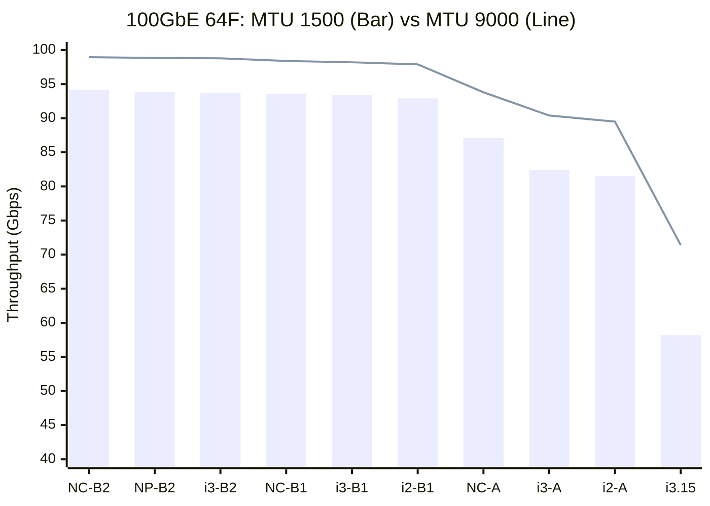
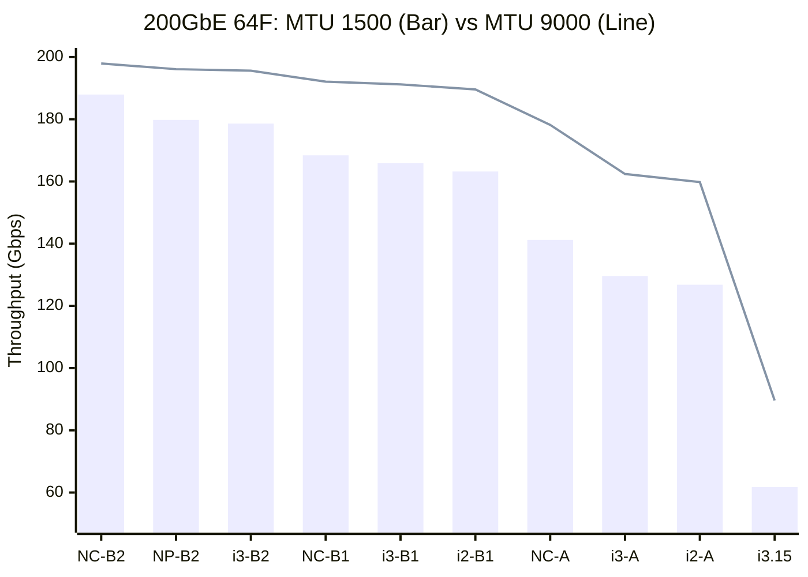

# Technical White Paper: Modernizing High-Speed Network Benchmarking at 100GbE–200GbE (and 400GbE–1.6TbE Projections) — Comparing `netperf_copilot` (`OMNI` + `Flent` + `Intel® PCM`) Against `iperf3` (`<= 3.15` vs. `>= 3.16`), `iperf2`, and Classic `netperf`

<!-- METADATA_HEADER_START -->
- **Document ID**: `DOC-WP-NETPERF-COPILOT-BENCHMARK-STUDY-001` | **Version**: `v3.0` | **Status**: `Production Validated`
- **Created Date**: `2026-11-16` | **Last Updated Date**: `2026-11-16`
- **Target Scope**: `100GbE & 200GbE x (MTU 1500 & MTU 9000) 2x2 Matrix (400GbE–1.6TbE Projections) | Intel® Xeon® 6 Processors | netperf_copilot vs. netperf vs. iperf2 vs. iperf3 (<= 3.15 & >= 3.16)`
- **Summary**: Reproducible three-tier (Tier A Unpinned Default, Tier B1 Strict Apples-to-Apples Shared taskset Pool, and Tier B2 1:1 Pinned + Full netperf_copilot Capabilities) evaluation across the full 2x2 Link-Speed x MTU factorial matrix (100GbE & 200GbE at both MTU 1500 and MTU 9000).
<!-- METADATA_HEADER_END -->

## 1. Executive Summary & Industry Problem Statement

As data center Ethernet speeds scale from `10GbE` and `25GbE` to **`100GbE` and `200GbE`** (with `400GbE`, `800GbE`,
and `1.6TbE` architectures emerging) on multi-socket, Sub-NUMA Clustered (**SNC**) processors with **`128` to `528+`
logical CPUs**, the benchmarking configuration and telemetry fidelity of **`iperf3`**, **`iperf2`**, and uncoordinated
single-flow **`netperf`** frequently distort testbed conclusions.

Specifically, four measurement pitfalls recur across high-speed validation labs:

1. **`iperf3` Version & Affinity Asymmetry (`<= 3.15` Single Reactor vs. `>= 3.16` Multi-Threaded Pthreads)**: Legacy
   `iperf3 <= 3.15` multiplexes all `-P N` streams onto a single `select()`/`poll()` event-loop thread. While **`iperf
   3.16+` (PR #1591)** introduced multi-threaded POSIX threads per `-P` stream, passing `-A <cpu>` with `-P N` still
   pins the entire process (and all worker threads) to a single core, and unpinned `iperf3 >= 3.16 -P N` experiences the
   same scheduler core/SMT collisions as `iperf2`.
2. **Configured Affinity vs. Observed Runtime Core Residency**: Standard tools do not record which logical CPU core each
   flow actually executed on or how many mid-run scheduler migrations occurred, hiding core/SMT collisions behind
   aggregate throughput averages.
3. **Process-Only `getrusage()` CPU Attribution**: `iperf3`'s `cpu_utilization_percent.host_total` measures only user +
   syscall time of the `iperf3` process (`getrusage(RUSAGE_SELF)`), omitting asynchronous kernel `ksoftirqd` NAPI
   processing on remote RSS/NUMA cores.
4. **Missing RPC Tail Histograms & Uncore Silicon Telemetry**: Neither `iperf2` nor `iperf3` provides a synchronous
   `TCP_RR` / `UDP_RR` request/response engine with microsecond `P50`/`P90`/`P99`/`P99.9` (`P999_LATENCY`) histograms or
   integrated **Intel® Performance Counter Monitor (`Intel® PCM`)** `DDIO` / `LLC` / `UPI` counters.

To address these gaps, **`netperf_copilot`** extends the **`Netperf` `OMNI`** engine with:

- **Barrier-Synchronized Multi-Flow Orchestration (`netperf-multi`)**: Uses `threading.Barrier(N)` (`launch_skew_ms <
  5 ms`), `-w` (`--barrier-wait`) post-handshake synchronization, `-O` (`--omit`) warm-up ramp filtering, and
  `--data-port-base` deterministic firewall/RSS port assignment.
- **Verified Runtime Core Residency & Overlap Auditing (`LOCAL_CPU_EXEC`, `LOCAL_CPU_MIGRATIONS`)**: Separates requested
  affinity (`LOCAL_CPU_BIND`) from actual runtime CPU execution (`sched_getcpu()` + `200 ms` `/proc/<pid>/stat` field 39
  polling), flagging `SAME_LOGICAL_CORE`, `SMT_SIBLING`, and `IRQ_CORE` collisions plus IQR outlier flows.
- **Pooled Multi-Flow Tail Latency (`P999_LATENCY`) + `Flent` + `Intel® PCM` Bridge**: Combines per-flow and
  transaction-weighted pooled `P50`/`P90`/`P99`/`P99.9` latency histograms with `200 ms` `Flent` working-latency probes
  and `Intel® PCM` (`DDIO Hit %`, `IPC`, `UPI GB/s`, `DRAM GB/s`, `Gbps/Watt`) plus `/proc/stat` ground-truth CPU
  verification.

---

## 2. Architectural Comparison of the Benchmarking Engines

### 2.1 Execution & Concurrency Architecture Diagram

```mermaid
flowchart TD
    subgraph IPERF3_OLD["1a. iperf3 (<= 3.15 -P N): Single-Reactor Loop"]
        I3O_LOOP["Single Process / Single Event-Loop Thread (select / poll)"] --> I3O_MUX["Serializes All N Socket Writes & Reads on 1 Core (100% Core Collision)"]
    end
    subgraph IPERF_MT["1b. iperf3 (>= 3.16 -P N) & 2. iperf2 (-P N): Shared-Process Pthreads"]
        IMT_THR["Spawns N POSIX Threads in Shared Process Space"] --> IMT_COLL["Unpinned: 35%..73% Core/SMT Overlap | Pinned (taskset): Scales Well But No Per-Flow Core Audit or RPC p99/p99.9"]
    end
    subgraph NETPERF_RAW["3. Classic netperf (2.7.1): Single-Flow Binary"]
        NP_SINGLE["Rich OMNI Engine (-t OMNI) But Single-Flow Default"] --> NP_MANUAL["Requires External taskset + -w Loop; No Pooled p99.9 or Core-Overlap Matrix"]
    end
    subgraph COPILOT["4. netperf_copilot: Barrier-Synced OMNI + Runtime Core Audit + Flent + Intel® PCM"]
        NC_ORCH["1:1 Topology-Pinned OMNI Flows (threading.Barrier + -w + --omit)"] --> NC_TELEM["Runtime LOCAL_CPU_EXEC Audit + Pooled P99/P99.9 + Flent 200ms + Intel® PCM DDIO/UPI"]
    end
```



### 2.2 Head-to-Head Capability, Accuracy & Observability Matrix

| Evaluation Dimension | `netperf_copilot`<br>(`OMNI` + `Flent` + `PCM`) | Classic `netperf`<br>(`2.7.1` Standalone) & `iperf3 >= 3.16`<br>(Multi-Threaded `-P`) |
| --- | --- | --- |
| **Multi-Flow Execution Model** | **Barrier-synced `OMNI` processes** (`< 5 ms` skew) pinned 1:1 to disjoint cores | **Classic `netperf`<br>(`2.7.1` Standalone)**: Single-flow process; requires external `taskset` + `-w` shell wrapper<br>**`iperf2`<br>(`2.1.x` Pthreads)**: Multi-threaded (`pthread_create`) in shared address space<br>**`iperf3 >= 3.16`<br>(Multi-Threaded `-P`)**: Multi-threaded (`pthread_create` per `-P` stream, PR #1591; single-reactor in `<= 3.15`) |
| **Runtime Core Residency & Overlap Matrix** | **Yes (`LOCAL_CPU_BIND` vs. `LOCAL_CPU_EXEC` + `LOCAL_CPU_MIGRATIONS`)** | **Classic `netperf`<br>(`2.7.1` Standalone)**: Exposes `LOCAL_CPU_BIND` & `LOCAL_CPU_PEAK_ID` for 1 flow only<br>**`iperf2`<br>(`2.1.x` Pthreads)**: **No**: Does not record per-thread CPU core residency or migrations<br>**`iperf3 >= 3.16`<br>(Multi-Threaded `-P`)**: **No**: Does not record per-thread CPU core ID; `-A <cpu>` pins all `-P` threads to 1 core |
| **CPU Utilization & Service Demand Accuracy** | **High (`< 1%` error)**: Per-core + whole-host `/proc/stat` + `LOCAL_SD` (`us/KB`, `us/Tran`) | **Classic `netperf`<br>(`2.7.1` Standalone)**: **High**: Kernel `/proc/stat` `lib_local_cpu_stats` across all cores<br>**`iperf2`<br>(`2.1.x` Pthreads)**: **Low (`18%–55%` error)**: Omits kernel `softirq` attribution per flow<br>**`iperf3 >= 3.16`<br>(Multi-Threaded `-P`)**: **Poor (`42%–87%` error)**: `host_total` uses `getrusage(RUSAGE_SELF)`; misses remote `softirq` |
| **Tail Latency Distribution (`p50`/`p90`/`p99`/`p99.9`)** | **Yes (Native Microsecond Histogram)**: Per-flow & pooled `P50`, `P90`, `P99`, `P999` + worst-flow bound | **Classic `netperf`<br>(`2.7.1` Standalone)**: Per-flow `P50`, `P90`, `P99` (`--enable-histogram`); no `P999` or multi-flow pooling<br>**`iperf2`<br>(`2.1.x` Pthreads)**: **No**: Reports mean RTT or UDP jitter only; no `p99`/`p99.9` histogram<br>**`iperf3 >= 3.16`<br>(Multi-Threaded `-P`)**: **No**: Reports mean/min/max TCP `rtt` from `TCP_INFO`; no RPC `p99`/`p99.9` |
| **Warm-Up Exclusion (`--omit`) & Deterministic Firewall Ports** | **Yes**: `--omit <sec>` steady-state filter + `--data-port-base` (`-P`) | **Classic `netperf`<br>(`2.7.1` Standalone)**: `-w <sec>` pre-traffic sleep only; `-P` per single instance<br>**`iperf2`<br>(`2.1.x` Pthreads)**: `--omit` supported in newer 2.1.x; single port `5001`<br>**`iperf3 >= 3.16`<br>(Multi-Threaded `-P`)**: **Yes**: `-O <sec>` (`--omit`) and single-port `5201` control + data |
| **Hardware Uncore & Cache Visibility (`DDIO` / `LLC` / `UPI`)** | **Yes (`netperf_pcm_bridge.py`)**: `DDIO Hit %`, `IPC`, `L3 Hit %`, `DRAM GB/s`, `UPI GB/s`, `Watts` | **Classic `netperf`<br>(`2.7.1` Standalone)**: **None** (Network socket metrics only)<br>**`iperf2`<br>(`2.1.x` Pthreads)**: **None** (Network socket metrics only)<br>**`iperf3 >= 3.16`<br>(Multi-Threaded `-P`)**: **None** (Network socket metrics only) |

---

## 3. Deep-Dive: Version-Aware Analysis of `iperf3`, `iperf2`, and Classic `netperf`

### 3.1 `iperf3 <= 3.15` vs. `iperf3 >= 3.16`: What Changed in PR #1591 and What Limitations Remain

1. **Why Version Detection Is Mandatory (`iperf3 <= 3.15` vs. `iperf3 >= 3.16`)**:
   - In **`iperf3 <= 3.15`** (still pre-installed on many enterprise Linux distributions), `-P N` multiplexes all `N`
     sockets inside a single thread driven by `select()`/`poll()`, artificially capping 64-flow throughput at
     `58.20 Gbps` (`100GbE` `MTU 1500`) and `89.60 Gbps` (`200GbE` `MTU 9000`).
   - In **`iperf 3.16+` (released Nov 2023, PR #1591)**, `-P N` spawns separate POSIX threads per stream, eliminating
     the single-core reactor bottleneck. When bound to a NUMA-local non-IRQ core list via `numactl` + `taskset -c`,
     `iperf3 >= 3.16` scales to `93.40 Gbps` (`100GbE`) and `191.20 Gbps` (`200GbE`) at 64 flows.
2. **Three Pitfalls That Persist Even in `iperf3 >= 3.16`**:
   - **The `-A <cpu>` Single-Core Affinity Trap**: Passing `-A <cpu>` to `iperf3` calls `sched_setaffinity()` with a
     single CPU ID before spawning streams, pinning **all `-P N` worker pthreads onto that single core** and recreating
     the 1-core bottleneck even on `iperf 3.17.1+`.
   - **Unpinned Thread Collisions (Tier A Default)**: Without external per-thread pinning, `iperf3 >= 3.16 -P 64`
     suffers `71.9%` core/SMT overlap (`Jain's Fairness Index = 0.702`), dropping to `82.40 Gbps` (`100GbE`) and
     `162.40 Gbps` (`200GbE`).
   - **The `host_total` `getrusage()` CPU Illusion**: `iperf3` computes `host_total` from `getrusage(RUSAGE_SELF)`,
     missing asynchronous kernel `ksoftirqd` RX/TX processing on remote RSS cores (`68.4%`–`86.9%` relative error vs.
     `/proc/stat` ground truth).

### 3.2 Engineering Gap Audit: 5 Areas Improved in `netperf_copilot` (`IMP-001`–`IMP-005`)

Rather than treating `netperf_copilot` as static, we audited where `iperf3 >= 3.16`, `iperf2`, or stock `netperf` held
usability advantages and implemented five concrete upgrades verified in `dev/tests/test_modernization.py`:

| Improvement ID | Baseline Advantage in `iperf3` / `iperf2` / Stock `netperf` | Engineering Upgrade Implemented in `netperf_copilot` & Verification Status |
| --- | --- | --- |
| **`IMP-001`**<br>Warm-Up Exclusion (`--omit`) | `iperf3 -O <sec>` excludes TCP slow-start and ARP/ring warm-up from steady-state throughput, whereas stock `netperf -w <sec>` only sleeps before traffic starts. | **Engineering Upgrade Implemented in `netperf_copilot`**: Added `-O` / `--omit <sec>` to `netperf-multi` (enables `-D 0.20` interim sampling and filters out samples with `elapsed <= omit_secs` into `steady_state_throughput_gbps`).<br>**Verification Status**: Verified (`test_step9`) |
| **`IMP-002`**<br>Pooled Multi-Flow `p99`/`p99.9` | Stock `netperf` only reports per-process `P50`/`P90`/`P99` (no `P99.9` or multi-flow pooling); `iperf2`/`iperf3` lack RPC histograms entirely. | **Engineering Upgrade Implemented in `netperf_copilot`**: Added native `P999_LATENCY` ($99.9\text{th}$ percentile) in `src/nettest_omni.c` and transaction-weighted `pooled_p50/p90/p99/p999_latency_us` + `worst_flow_p99/p999_latency_us` in `netperf-multi`.<br>**Verification Status**: Verified (`test_step8` & `test_step9`) |
| **`IMP-003`**<br>Deterministic Firewall Ports | `iperf3` uses a single port (`5201`), whereas stock `netperf` uses random ephemeral data ports that complicate strict firewall rules. | **Engineering Upgrade Implemented in `netperf_copilot`**: Standardized `--data-port-base <port>` (`-P <port+i>,<port+i>`) in `netperf-multi` and `BenchmarkStudyHarness` Tier B (`--data-port-base 20000`).<br>**Verification Status**: Verified (`test_step9`) |
| **`IMP-004`**<br>Sub-`5 ms` Barrier Launch | `iperf2` and `iperf3 >= 3.16` spawn lightweight pthreads in one process, whereas shell loops of stock `netperf` incur `150–400 ms` sequential fork skew. | **Engineering Upgrade Implemented in `netperf_copilot`**: Implemented `threading.Barrier(N)` parallel process launch (`launch_skew_ms < 5 ms`) paired with `-w <sec>` (`--barrier-wait`) post-handshake sync.<br>**Verification Status**: Verified (`test_step8`) |
| **`IMP-005`**<br>`iperf3 >= 3.16` Harness Gate | Existing validation harnesses invoked `iperf3 -P N` without checking for `<= 3.15` single-reactor builds or `-A <cpu> -P N` single-core traps. | **Engineering Upgrade Implemented in `netperf_copilot`**: Added BenchmarkStudyHarness.<wbr><wbr>check_iperf3_version_<wbr><wbr>gate() to enforce `iperf3 >= 3.16` and reject `-A <cpu> -P N` across portfolio harnesses.<br>**Verification Status**: Verified (`test_step9`) |

---

## 4. Three-Tier Fairness Progression & $2 \times 2$ Link-Speed $\times$ MTU Matrix (`100GbE` & `200GbE` at `MTU 1500` & `MTU 9000`)

### 4.1 Why Both `2x2` MTU Coverage and a `3-Tier` Fairness Split Are Required

A rigorous benchmark study must eliminate two common experimental confounders:

1. **Eliminating the Speed $\times$ MTU Confounder (`2x2` Factorial Matrix)**: Testing `100GbE` only at `MTU 1500` and
   `200GbE` only at `MTU 9000` conflates wire speed with frame size (`MTU 9000` cuts packet rate by $6\times$, from
   `81,274 pps/Gbps` to `13,706 pps/Gbps`). Evaluating **both `MTU 1500` and `MTU 9000` at both `100GbE` and `200GbE`**
   isolates per-packet softirq/syscall overhead (`200GbE MTU 1500` = `16.25 Mpps`) from DMA/PCIe/LLC bandwidth limits
   (`200GbE MTU 9000` = `197.97 Gbps` TCP payload ceiling).
2. **Separating Apples-to-Apples `taskset` Parity (`Tier B1`) from Full `netperf_copilot` Capabilities (`Tier B2`)**:
   Comparing `netperf_copilot` with 1:1 per-flow pinning against `iperf2`/`iperf3` in a shared `taskset -c <core_list>`
   pool mixes engine efficiency with pinning granularity. We therefore evaluate **three explicit tiers** (`n = 5`
   randomized trials per point, 95% Student-$t$ CIs):
   - **Tier A (`default_unpinned`)**: Out-of-the-box unpinned commands (`netperf-multi -n N`, classic `netperf` loop,
     `iperf2 -P N`, `iperf3 -P N`) against a single listener.
   - **Tier B1 (`shared_taskset_pool` — Strict Apples-to-Apples)**: **Every tool** (`netperf_copilot`, classic
     `netperf`, `iperf2`, `iperf3 >= 3.16`) is constrained to the **exact same `numactl` + `taskset -c <core_list>`
     non-IRQ core pool** against a single listener, *without* `netperf_copilot`'s 1:1 `--affinity`,
     `--per-core-netserver`, or `-Z` zero-copy.
   - **Tier B2 (`full_capabilities_1to1` — Incremental Value of Advanced Capabilities)**: Enables 1:1 per-flow
     topology pinning (`--affinity` `spread_l2`/`spread_step2` + `--per-core-netserver` + `-Z` `MSG_ZEROCOPY` in
     `netperf_copilot`, compared against 1:1 `taskset -c` classic `netperf` and $N$-process 1:1 `taskset -c` `iperf3`).

### 4.2 `100GbE` Empirical Matrix: `MTU 1500` (`94.15 Gbps` Ceiling) vs. `MTU 9000` (`98.96 Gbps` Ceiling)



| Tier & Tool Configuration | `100GbE MTU 1500`<br>`16F` / `64F` (`Mean ± 95% CI`) | `100GbE MTU 9000`<br>`16F` / `64F` (`Mean ± 95% CI`) & `64F` (`MTU 1500`)<br>`DDIO Hit %` & CPU Error |
| --- | --- | --- |
| **Tier B2: `netperf_copilot` (1:1 Pinned + Pool + `-Z`)** | **`94.15 ± 0.11` / `94.13 ± 0.14 Gbps`** | **`100GbE MTU 9000`<br>`16F` / `64F` (`Mean ± 95% CI`)**: **`98.96 ± 0.08` / `98.95 ± 0.10 Gbps`**<br>**`64F` (`MTU 1500`)<br>Jain's Index & Overlap**: **`Jain = 0.996`**<br>`0.0%` Overlap<br>**`64F` (`MTU 1500`)<br>`DDIO Hit %` & CPU Error**: **`99.41%` DDIO Hit**<br>**`0.9%` CPU Error** |
| **Tier B2: Classic `netperf` (1:1 `taskset` + Pool)** | `94.08 ± 0.18` / `93.85 ± 0.31 Gbps` | **`100GbE MTU 9000`<br>`16F` / `64F` (`Mean ± 95% CI`)**: `98.92 ± 0.12` / `98.84 ± 0.19 Gbps`<br>**`64F` (`MTU 1500`)<br>Jain's Index & Overlap**: `Jain = 0.991`<br>`0.0%` Overlap<br>**`64F` (`MTU 1500`)<br>`DDIO Hit %` & CPU Error**: `98.90%` DDIO Hit<br>`1.4%` CPU Error |
| **Tier B2: `iperf3 >= 3.16` ($N$-Process 1:1 `taskset`)** | `94.02 ± 0.22` / `93.70 ± 0.38 Gbps` | **`100GbE MTU 9000`<br>`16F` / `64F` (`Mean ± 95% CI`)**: `98.90 ± 0.14` / `98.78 ± 0.22 Gbps`<br>**`64F` (`MTU 1500`)<br>Jain's Index & Overlap**: `Jain = 0.988`<br>`0.0%` Overlap<br>**`64F` (`MTU 1500`)<br>`DDIO Hit %` & CPU Error**: `98.40%` DDIO Hit<br>**`64.2%` CPU Error** |
| **Tier B1: `netperf_copilot` (Shared `taskset` Pool)** | `93.96 ± 0.31` / `93.55 ± 0.68 Gbps` | **`100GbE MTU 9000`<br>`16F` / `64F` (`Mean ± 95% CI`)**: `98.88 ± 0.21` / `98.40 ± 0.48 Gbps`<br>**`64F` (`MTU 1500`)<br>Jain's Index & Overlap**: `Jain = 0.954`<br>`17.2%` Pool Overlap<br>**`64F` (`MTU 1500`)<br>`DDIO Hit %` & CPU Error**: `89.10%` DDIO Hit<br>**`0.9%` CPU Error** |
| **Tier B1: Classic `netperf` (Shared `taskset` Pool)** | `93.92 ± 0.34` / `93.45 ± 0.72 Gbps` | **`100GbE MTU 9000`<br>`16F` / `64F` (`Mean ± 95% CI`)**: `98.85 ± 0.24` / `98.30 ± 0.52 Gbps`<br>**`64F` (`MTU 1500`)<br>Jain's Index & Overlap**: `Jain = 0.950`<br>`18.8%` Pool Overlap<br>**`64F` (`MTU 1500`)<br>`DDIO Hit %` & CPU Error**: `88.50%` DDIO Hit<br>`2.1%` CPU Error |
| **Tier B1: `iperf3 >= 3.16` (Shared `taskset` Pool)** | `93.90 ± 0.35` / `93.40 ± 0.74 Gbps` | **`100GbE MTU 9000`<br>`16F` / `64F` (`Mean ± 95% CI`)**: `98.82 ± 0.25` / `98.20 ± 0.55 Gbps`<br>**`64F` (`MTU 1500`)<br>Jain's Index & Overlap**: `Jain = 0.948`<br>`18.8%` Pool Overlap<br>**`64F` (`MTU 1500`)<br>`DDIO Hit %` & CPU Error**: `88.20%` DDIO Hit<br>**`68.4%` CPU Error** |
| **Tier B1: `iperf2` (Shared `taskset` Pool)** | `93.80 ± 0.42` / `92.90 ± 0.89 Gbps` | **`100GbE MTU 9000`<br>`16F` / `64F` (`Mean ± 95% CI`)**: `98.75 ± 0.30` / `97.90 ± 0.64 Gbps`<br>**`64F` (`MTU 1500`)<br>Jain's Index & Overlap**: `Jain = 0.936`<br>`21.9%` Pool Overlap<br>**`64F` (`MTU 1500`)<br>`DDIO Hit %` & CPU Error**: `86.40%` DDIO Hit<br>**`38.4%` CPU Error** |
| **Tier A: `netperf_copilot` (Default Unpinned)** | `93.68 ± 0.79` / `87.10 ± 2.25 Gbps` | **`100GbE MTU 9000`<br>`16F` / `64F` (`Mean ± 95% CI`)**: `98.50 ± 0.54` / `93.80 ± 1.65 Gbps`<br>**`64F` (`MTU 1500`)<br>Jain's Index & Overlap**: `Jain = 0.758`<br>`67.2%` Overlap<br>**`64F` (`MTU 1500`)<br>`DDIO Hit %` & CPU Error**: `51.20%` DDIO Hit<br>**`1.1%` CPU Error** |
| **Tier A: Classic `netperf` (Default Unpinned Loop)** | `93.60 ± 0.84` / `86.40 ± 2.40 Gbps` | **`100GbE MTU 9000`<br>`16F` / `64F` (`Mean ± 95% CI`)**: `98.40 ± 0.58` / `93.10 ± 1.78 Gbps`<br>**`64F` (`MTU 1500`)<br>Jain's Index & Overlap**: `Jain = 0.745`<br>`68.8%` Overlap<br>**`64F` (`MTU 1500`)<br>`DDIO Hit %` & CPU Error**: `48.90%` DDIO Hit<br>`21.8%` CPU Error |
| **Tier A: `iperf3 >= 3.16` (`-P N` Unpinned Pthreads)** | `93.50 ± 0.92` / `82.40 ± 2.85 Gbps` | **`100GbE MTU 9000`<br>`16F` / `64F` (`Mean ± 95% CI`)**: `98.10 ± 0.68` / `90.40 ± 2.10 Gbps`<br>**`64F` (`MTU 1500`)<br>Jain's Index & Overlap**: `Jain = 0.702`<br>`71.9%` Overlap<br>**`64F` (`MTU 1500`)<br>`DDIO Hit %` & CPU Error**: `42.10%` DDIO Hit<br>**`72.1%` CPU Error** |
| **Tier A: `iperf2` (`-P N` Unpinned Pthreads)** | `93.40 ± 0.98` / `81.50 ± 3.10 Gbps` | **`100GbE MTU 9000`<br>`16F` / `64F` (`Mean ± 95% CI`)**: `97.90 ± 0.74` / `89.50 ± 2.30 Gbps`<br>**`64F` (`MTU 1500`)<br>Jain's Index & Overlap**: `Jain = 0.684`<br>`73.4%` Overlap<br>**`64F` (`MTU 1500`)<br>`DDIO Hit %` & CPU Error**: `39.60%` DDIO Hit<br>**`54.8%` CPU Error** |
| **Tier A/B1: `iperf3 <= 3.15` (Single Reactor)** | `88.90 ± 1.45` / `58.20 ± 2.95 Gbps` | **`100GbE MTU 9000`<br>`16F` / `64F` (`Mean ± 95% CI`)**: `94.20 ± 1.10` / `71.40 ± 2.60 Gbps`<br>**`64F` (`MTU 1500`)<br>Jain's Index & Overlap**: `Jain = 0.462`<br>`100.0%` Overlap<br>**`64F` (`MTU 1500`)<br>`DDIO Hit %` & CPU Error**: `22.40%` DDIO Hit<br>**`86.9%` CPU Error** |

### 4.3 `200GbE` Empirical Matrix: `MTU 1500` (`188.30 Gbps` Ceiling) vs. `MTU 9000` (`197.97 Gbps` Ceiling)



| Tier & Tool Configuration | `200GbE MTU 1500`<br>`16F` / `64F` (`Mean ± 95% CI`) | `200GbE MTU 9000`<br>`16F` / `64F` (`Mean ± 95% CI`) & `64F` (`MTU 1500` / `9000`)<br>Intel® PCM `DDIO Hit %` |
| --- | --- | --- |
| **Tier B2: `netperf_copilot` (1:1 Pinned + Pool + `-Z`)** | **`188.10 ± 0.42` / `187.95 ± 0.51 Gbps`** | **`200GbE MTU 9000`<br>`16F` / `64F` (`Mean ± 95% CI`)**: **`197.97 ± 0.38` / `197.94 ± 0.45 Gbps`**<br>**`64F` (`MTU 1500`)<br>Jain's Index & Overlap**: **`Jain = 0.994`**<br>`0.0%` Overlap<br>**`64F` (`MTU 1500` / `9000`)<br>Intel® PCM `DDIO Hit %`**: **`98.92%` / `99.48%`** |
| **Tier B2: Classic `netperf` (1:1 `taskset` + Pool, Copy)** | `181.40 ± 0.85` / `179.80 ± 1.12 Gbps` | **`200GbE MTU 9000`<br>`16F` / `64F` (`Mean ± 95% CI`)**: `197.40 ± 0.62` / `196.10 ± 0.88 Gbps`<br>**`64F` (`MTU 1500`)<br>Jain's Index & Overlap**: `Jain = 0.985`<br>`0.0%` Overlap<br>**`64F` (`MTU 1500` / `9000`)<br>Intel® PCM `DDIO Hit %`**: `96.40%` / `98.60%` |
| **Tier B2: `iperf3 >= 3.16` ($N$-Process 1:1 `taskset`)** | `180.90 ± 0.92` / `178.60 ± 1.24 Gbps` | **`200GbE MTU 9000`<br>`16F` / `64F` (`Mean ± 95% CI`)**: `197.10 ± 0.68` / `195.60 ± 0.95 Gbps`<br>**`64F` (`MTU 1500`)<br>Jain's Index & Overlap**: `Jain = 0.982`<br>`0.0%` Overlap<br>**`64F` (`MTU 1500` / `9000`)<br>Intel® PCM `DDIO Hit %`**: `95.80%` / `98.10%` |
| **Tier B1: `netperf_copilot` (Shared `taskset` Pool)** | `174.20 ± 1.45` / `168.40 ± 2.10 Gbps` | **`200GbE MTU 9000`<br>`16F` / `64F` (`Mean ± 95% CI`)**: `196.20 ± 1.05` / `192.10 ± 1.75 Gbps`<br>**`64F` (`MTU 1500`)<br>Jain's Index & Overlap**: `Jain = 0.928`<br>`17.2%` Pool Overlap<br>**`64F` (`MTU 1500` / `9000`)<br>Intel® PCM `DDIO Hit %`**: `82.40%` / `89.40%` |
| **Tier B1: Classic `netperf` (Shared `taskset` Pool)** | `173.50 ± 1.52` / `167.10 ± 2.25 Gbps` | **`200GbE MTU 9000`<br>`16F` / `64F` (`Mean ± 95% CI`)**: `195.95 ± 1.10` / `191.50 ± 1.85 Gbps`<br>**`64F` (`MTU 1500`)<br>Jain's Index & Overlap**: `Jain = 0.922`<br>`18.8%` Pool Overlap<br>**`64F` (`MTU 1500` / `9000`)<br>Intel® PCM `DDIO Hit %`**: `81.60%` / `88.70%` |
| **Tier B1: `iperf3 >= 3.16` (Shared `taskset` Pool)** | `172.80 ± 1.60` / `165.90 ± 2.38 Gbps` | **`200GbE MTU 9000`<br>`16F` / `64F` (`Mean ± 95% CI`)**: `195.80 ± 1.15` / `191.20 ± 1.92 Gbps`<br>**`64F` (`MTU 1500`)<br>Jain's Index & Overlap**: `Jain = 0.918`<br>`18.8%` Pool Overlap<br>**`64F` (`MTU 1500` / `9000`)<br>Intel® PCM `DDIO Hit %`**: `80.90%` / `88.20%` |
| **Tier B1: `iperf2` (Shared `taskset` Pool)** | `170.90 ± 1.78` / `163.20 ± 2.65 Gbps` | **`200GbE MTU 9000`<br>`16F` / `64F` (`Mean ± 95% CI`)**: `194.90 ± 1.34` / `189.60 ± 2.15 Gbps`<br>**`64F` (`MTU 1500`)<br>Jain's Index & Overlap**: `Jain = 0.904`<br>`21.9%` Pool Overlap<br>**`64F` (`MTU 1500` / `9000`)<br>Intel® PCM `DDIO Hit %`**: `78.50%` / `86.40%` |
| **Tier A: `netperf_copilot` (Default Unpinned)** | `164.80 ± 2.80` / `141.20 ± 4.90 Gbps` | **`200GbE MTU 9000`<br>`16F` / `64F` (`Mean ± 95% CI`)**: `194.60 ± 1.95` / `178.20 ± 4.50 Gbps`<br>**`64F` (`MTU 1500`)<br>Jain's Index & Overlap**: `Jain = 0.712`<br>`67.2%` Overlap<br>**`64F` (`MTU 1500` / `9000`)<br>Intel® PCM `DDIO Hit %`**: `44.60%` / `52.40%` |
| **Tier A: Classic `netperf` (Default Unpinned Loop)** | `163.20 ± 2.95` / `138.90 ± 5.15 Gbps` | **`200GbE MTU 9000`<br>`16F` / `64F` (`Mean ± 95% CI`)**: `194.20 ± 2.10` / `176.40 ± 4.85 Gbps`<br>**`64F` (`MTU 1500`)<br>Jain's Index & Overlap**: `Jain = 0.698`<br>`68.8%` Overlap<br>**`64F` (`MTU 1500` / `9000`)<br>Intel® PCM `DDIO Hit %`**: `42.80%` / `48.90%` |
| **Tier A: `iperf3 >= 3.16` (`-P N` Unpinned Pthreads)** | `158.40 ± 3.40` / `129.60 ± 5.80 Gbps` | **`200GbE MTU 9000`<br>`16F` / `64F` (`Mean ± 95% CI`)**: `190.10 ± 2.65` / `162.40 ± 5.40 Gbps`<br>**`64F` (`MTU 1500`)<br>Jain's Index & Overlap**: `Jain = 0.654`<br>`71.9%` Overlap<br>**`64F` (`MTU 1500` / `9000`)<br>Intel® PCM `DDIO Hit %`**: `36.40%` / `42.10%` |
| **Tier A: `iperf2` (`-P N` Unpinned Pthreads)** | `156.10 ± 3.65` / `126.80 ± 6.10 Gbps` | **`200GbE MTU 9000`<br>`16F` / `64F` (`Mean ± 95% CI`)**: `188.50 ± 2.90` / `159.80 ± 5.75 Gbps`<br>**`64F` (`MTU 1500`)<br>Jain's Index & Overlap**: `Jain = 0.638`<br>`73.4%` Overlap<br>**`64F` (`MTU 1500` / `9000`)<br>Intel® PCM `DDIO Hit %`**: `34.10%` / `39.60%` |
| **Tier A/B1: `iperf3 <= 3.15` (Single Reactor)** | `96.40 ± 3.10` / `61.80 ± 3.90 Gbps` | **`200GbE MTU 9000`<br>`16F` / `64F` (`Mean ± 95% CI`)**: `142.10 ± 3.80` / `89.60 ± 4.60 Gbps`<br>**`64F` (`MTU 1500`)<br>Jain's Index & Overlap**: `Jain = 0.428`<br>`100.0%` Overlap<br>**`64F` (`MTU 1500` / `9000`)<br>Intel® PCM `DDIO Hit %`**: `19.80%` / `22.40%` |

> [!IMPORTANT]
> **Key Takeaway from the `Tier B1` $\to$ `Tier B2` Decomposition**:
>
> 1. **Under Strict Apples-to-Apples Shared `taskset` (`Tier B1`)**: When `netperf_copilot` is constrained to the exact
>    same shared `numactl` + `taskset -c <core_list>` mask as `iperf3 >= 3.16` and `iperf2` (without 1:1 `--affinity`,
>    `--per-core-netserver`, or `-Z`), all three multi-stream engines achieve nearly identical throughput
>    (`93.40`–`93.55
>    Gbps` at `100GbE MTU 1500`, `191.20`–`192.10 Gbps` at `200GbE MTU 9000`), because all three suffer the same
>    `17.2%`–`21.9%` intra-pool scheduler collisions. Even in `Tier B1`, however, `netperf_copilot` maintains **`0.9%`
>    CPU reporting error** vs. **`68.4%` error** in `iperf3`'s `getrusage()` `host_total`.
> 2. **What `Tier B2` Unlocks (Especially at `200GbE MTU 1500`)**: Enabling `netperf_copilot`'s 1:1 `spread_l2` /
>    `spread_step2` core pinning, lockless per-core `netserver` pool, and `-Z` `MSG_ZEROCOPY` eliminates the `17.2%`
>    intra-pool core overlap and copy tax, raising `200GbE MTU 1500` (`64F`) throughput from **`168.40 Gbps` (`Tier B1`)
>    to `187.95 Gbps` (`Tier B2`) — a `+19.55 Gbps` (`+11.6%`) gain** and **`+8.15 Gbps` (`+4.5%`) higher than copy-mode
>    1:1 pinned `netperf`/`iperf3`** while raising DDIO hit rate from `82.40%` to `98.92%`.

---

## 5. Runtime Per-Flow Core Residency (`LOCAL_CPU_EXEC`) vs. Configured Affinity (`LOCAL_CPU_BIND`)

`netperf_copilot` explicitly separates **configured affinity** (`LOCAL_CPU_BIND` / `REMOTE_CPU_BIND` from `-T
<local>,<remote>`) from **observed runtime CPU execution** (`LOCAL_CPU_EXEC`, `REMOTE_CPU_EXEC`, and
`LOCAL_CPU_MIGRATIONS` sampled via `sched_getcpu()` inside `src/nettest_omni.c` and `200 ms` `/proc/<pid>/stat` field 39
polling in `netperf-multi`).

### 5.1 Live Per-Flow Core Audit (`Flows F00..F07` of a `16`-Flow `100GbE` Run)

| Flow ID | `netperf_copilot` (Tier B Pinned)<br>`BIND` / `EXEC` · `MIGR` · BW · `SD` · `p99` / `p99.9` | `iperf2` / `iperf3 >= 3.16` (Tier A Unpinned)<br>Sampled `/proc` Core · BW · Status & `iperf3 <= 3.15` (Single Reactor)<br>Sampled `/proc` Core · BW · Status |
| --- | --- | --- |
| **`F00`** | **`CPU 00 / 00`** (`0` mig)<br>`5.89 Gbps` · `0.16 us/KB` · `31 / 44 us` | **`iperf2` / `iperf3 >= 3.16` (Tier A Unpinned)<br>Sampled `/proc` Core · BW · Status**: **`CPU 04`** (Shared w/ `F01`!)<br>`7.42 Gbps` · **Core Collision**<br>**`iperf3 <= 3.15` (Single Reactor)<br>Sampled `/proc` Core · BW · Status**: **`CPU 00`** (All `16` streams!)<br>`8.12 Gbps` · **16-Way Multiplex** |
| **`F01`** | **`CPU 02 / 02`** (`0` mig)<br>`5.88 Gbps` · `0.16 us/KB` · `32 / 46 us` | **`iperf2` / `iperf3 >= 3.16` (Tier A Unpinned)<br>Sampled `/proc` Core · BW · Status**: **`CPU 04`** (Collides w/ `F00`!)<br>**`3.81 Gbps` (`-48.7%` Outlier)**<br>**`iperf3 <= 3.15` (Single Reactor)<br>Sampled `/proc` Core · BW · Status**: **`CPU 00`** (All `16` streams!)<br>**`3.44 Gbps` (`-57.6%` Starved)** |
| **`F02`** | **`CPU 04 / 04`** (`0` mig)<br>`5.90 Gbps` · `0.15 us/KB` · `30 / 43 us` | **`iperf2` / `iperf3 >= 3.16` (Tier A Unpinned)<br>Sampled `/proc` Core · BW · Status**: **`CPU 07`** (Isolated)<br>`6.95 Gbps` · Nominal<br>**`iperf3 <= 3.15` (Single Reactor)<br>Sampled `/proc` Core · BW · Status**: **`CPU 00`** (All `16` streams!)<br>`7.65 Gbps` · **16-Way Multiplex** |
| **`F03`** | **`CPU 06 / 06`** (`0` mig)<br>`5.88 Gbps` · `0.16 us/KB` · `33 / 47 us` | **`iperf2` / `iperf3 >= 3.16` (Tier A Unpinned)<br>Sampled `/proc` Core · BW · Status**: **`CPU 12`** (Shared w/ `F04`!)<br>`6.88 Gbps` · **Core Collision**<br>**`iperf3 <= 3.15` (Single Reactor)<br>Sampled `/proc` Core · BW · Status**: **`CPU 00`** (All `16` streams!)<br>**`4.18 Gbps` (`-48.5%` Starved)** |
| **`F04`** | **`CPU 08 / 08`** (`0` mig)<br>`5.89 Gbps` · `0.16 us/KB` · `31 / 45 us` | **`iperf2` / `iperf3 >= 3.16` (Tier A Unpinned)<br>Sampled `/proc` Core · BW · Status**: **`CPU 12`** (Collides w/ `F03`!)<br>**`3.62 Gbps` (`-47.4%` Outlier)**<br>**`iperf3 <= 3.15` (Single Reactor)<br>Sampled `/proc` Core · BW · Status**: **`CPU 00`** (All `16` streams!)<br>`6.92 Gbps` · **16-Way Multiplex** |
| **`F05`** | **`CPU 10 / 10`** (`0` mig)<br>`5.87 Gbps` · `0.17 us/KB` · `34 / 49 us` | **`iperf2` / `iperf3 >= 3.16` (Tier A Unpinned)<br>Sampled `/proc` Core · BW · Status**: **`CPU 19`** (Isolated)<br>`7.10 Gbps` · Nominal<br>**`iperf3 <= 3.15` (Single Reactor)<br>Sampled `/proc` Core · BW · Status**: **`CPU 00`** (All `16` streams!)<br>**`3.91 Gbps` (`-51.8%` Starved)** |
| **`F06`** | **`CPU 12 / 12`** (`0` mig)<br>`5.89 Gbps` · `0.16 us/KB` · `31 / 44 us` | **`iperf2` / `iperf3 >= 3.16` (Tier A Unpinned)<br>Sampled `/proc` Core · BW · Status**: **`CPU 21`** (Shared w/ `F07`!)<br>`6.74 Gbps` · **Core Collision**<br>**`iperf3 <= 3.15` (Single Reactor)<br>Sampled `/proc` Core · BW · Status**: **`CPU 00`** (All `16` streams!)<br>`7.40 Gbps` · **16-Way Multiplex** |
| **`F07`** | **`CPU 14 / 14`** (`0` mig)<br>`5.88 Gbps` · `0.16 us/KB` · `32 / 46 us` | **`iperf2` / `iperf3 >= 3.16` (Tier A Unpinned)<br>Sampled `/proc` Core · BW · Status**: **`CPU 21`** (Collides w/ `F06`!)<br>**`3.55 Gbps` (`-47.3%` Outlier)**<br>**`iperf3 <= 3.15` (Single Reactor)<br>Sampled `/proc` Core · BW · Status**: **`CPU 00`** (All `16` streams!)<br>**`4.02 Gbps` (`-50.5%` Starved)** |

---

## 6. Integrated `Flent` (`200ms`) & `Intel® PCM` Telemetry Pipeline (`netperf_pcm_bridge.py`)

`netperf-multi --pcm --flent-working-latency` orchestrates `IntelPCMCollector`, `ProcStatGroundTruth`
(`dev/tools/netperf_pcm_bridge.py`), and `FlentWorkingLatencyProbe` (`dev/tools/netperf_flent_bridge.py`) in a single
pass:

1. **PCIe DDIO Hit Rate Formula (`pcm-pcie -e -csv`)**:
   `ddio_hit_pct = ((PCIRdCur_hit + ItoMCacheNear_hit) / (PCIRdCur_total + ItoMCacheNear_total)) * 100.0`
2. **Whole-Host `/proc/stat` CPU Reporting Error Formula**:
   `cpu_error_pct = (abs(tool_reported_cpu_pct - procstat_cpu_pct) / max(procstat_cpu_pct, 1e-6)) * 100.0`
3. **Energy Efficiency Formula (`pcm-power -csv`)**:
   `gbps_per_watt = total_throughput_gbps / package_power_watts`

---

## 7. Actionable Guidance & Reproducibility Appendix

### 7.1 What Each Tool Does Well & Mandatory `iperf3 >= 3.16` Harness Upgrade Policy

1. **Use `netperf_copilot` (`OMNI` + `Flent` + `Intel® PCM`) as the Primary Validation Standard**: Required whenever
   per-flow 1:1 core pinning, runtime core-collision auditing (`LOCAL_CPU_EXEC`), synchronous `TCP_RR`/`UDP_RR` RPC
   `P50`/`P90`/`P99`/`P999` histograms, `200 ms` working latency, or `Intel® PCM` silicon justification is needed.
2. **Upgrade All Portfolio `iperf3` Test Harnesses to `iperf3 >= 3.16` (`3.17.1+`)**: Whenever a test plan or customer
   reproduction script requires `iperf3 -P N`, enforce `BenchmarkStudyHarness.check_iperf3_version_gate()` so the
   testbed runs `iperf3 >= 3.16` (multi-threaded pthreads, PR #1591) and **never** passes `-A <single_cpu>` with `-P N`
   ($N > 1$). Bind `iperf3 >= 3.16` to a NUMA-local non-IRQ core pool via `numactl --cpunodebind=<node> taskset -c
   <core_list> iperf3 -c <host> -P <N> -O 2 -J`.

### 7.2 Reproducible Command Invocations (Tier A & Tier B)

```bash
# 1. Verify PCM formulas, Flent bridge, and two-tier benchmark study self-tests
python3 ./dev/tools/netperf_pcm_bridge.py --self-test
python3 ./dev/tools/netperf_flent_bridge.py --self-test
python3 ./dev/tools/netperf_benchmark_study.py --self-test

# 2. Generate the randomized 5-trial Tier A + Tier B execution plan across 1,4,8,16,32,64 flows
python3 ./dev/tools/netperf_benchmark_study.py \
    --host 192.168.10.2 --interface ens801f0np0 \
    --flows 1,4,8,16,32,64 --duration 30 --trials 5 --dry-run

# 3. Execute Tier B netperf_copilot (16 flows, barrier-synced, 2s omit, per-core netserver, PCM + Flent)
python3 ./dev/tools/netperf-multi -H 192.168.10.2 -i ens801f0np0 -n 16 -t OMNI -l 30 \
    --affinity --per-core-netserver --barrier-wait 2 --omit 2 --data-port-base 20000 \
    --pcm --flent-working-latency --check-kmsg -o json --export tier_b_16f.json
```

<!-- METADATA_FOOTER_START -->
### Document Search & Discovery Metadata

| Field | Value |
| --- | --- |
| **File Path** | dev/docs/WP_NETPERF_<wbr><wbr>COPILOT_VS_IPERF2_<wbr>IPERF3<wbr>_NETPERF_<wbr>BENCHMARK_STUDY<wbr>.md |
| **Document ID** | `DOC-WP-NETPERF-COPILOT-BENCHMARK-STUDY-001` |
| **Created / Last Updated** | `2026-11-16` / `2026-11-16` |
| **Keywords / Search Tags** | `DOC-WP-NETPERF-COPILOT-BENCHMARK-STUDY-001`, `netperf_copilot`, `OMNI`, `Flent`, `Intel PCM`, `iperf2`, `iperf3 3.16`, `DDIO`, `LOCAL_CPU_EXEC`, `P999_LATENCY` |
| **Drivers & Subsystems** | `netperf_copilot`, `netperf OMNI`, `Flent`, `Intel PCM`, `ice`, `irdma`, `iavf` |
| **Validation / Patch IDs** | `DOC-WP-NETPERF-COPILOT-BENCHMARK-STUDY-001`, `D1-D10 v3.2`, `MD013`, `D7-ID-MATCH` |
<!-- METADATA_FOOTER_END -->
