# Netperf Evaluation & 2026 Modernization Plan (Phases 4–7)

## 1. Executive Evaluation of `netperf_copilot` Baseline (`v3.0.0`)

Earlier work on `netperf_copilot` completed **Phases 1–3** of the original 7-phase [`project-roadmap.md`](project-roadmap.md), transforming legacy Netperf 2.7.0 into a modernized baseline (`v3.0.0`).

### 1.1 Completed Foundation (Phases 1–3)
| Layer | Completed Enhancements | Key Files |
| :--- | :--- | :--- |
| **Build & Compiler** | Enabled `--enable-demo=yes` (interval reporting), `--enable-histogram=yes`, and `--enable-omni=yes` by default; created `-O3 -march=native -flto` build automation. | [`configure.ac`](../../configure.ac), [`dev/scripts/configure-optimized.sh`](../scripts/configure-optimized.sh) |
| **C Engine (`src/`)** | Raised `MAXCPUS` to `2048`; changed default OMNI output selector to `NETPERF_OUTPUT_KEYVAL`; added global `-M` shortcut for `OMNI` mode while preserving `TCP_STREAM` backwards compatibility; implemented `-- -J [file]` JSON output (`print_omni_json`) and RFC 4180 CSV escaping (`print_omni_csv`). | [`src/netlib.h`](../../src/netlib.h), [`src/netlib.c`](../../src/netlib.c), [`src/netsh.c`](../../src/netsh.c), [`src/nettest_omni.c`](../../src/nettest_omni.c) |
| **Python Tooling** | Built multi-instance launcher (`netperf-multi`), statistical analyzer (`netperf_stats.py`), YAML profile runner (`netperf-profile`), SSH multi-host orchestrator (`netperf-orchestrate`), real-time TUI (`netperf-monitor`), template generator (`netperf-template`), and aggregator (`netperf-aggregate`). | [`dev/tools/netperf-multi`](../tools/netperf-multi), [`dev/tools/netperf-profile`](../tools/netperf-profile), [`dev/tools/netperf-orchestrate`](../tools/netperf-orchestrate) |

### 1.2 Architectural Gaps Identified for 100G–800G NICs & Modern Multi-Core Platforms

Evaluating the Phase 1–3 baseline against modern 200GbE–800GbE adapters and high-core-count P-core/E-core processors revealed six major gaps:

1. **Load-Partner-Blind & Topology-Blind CPU Pinning**:
   - Local `taskset -c` round-robin assignment did not pass `-T local_core,remote_core` or `-p $((base_port + remote_core))` to match pinned Load Partner (LP) `netserver` instances, nor did it avoid NIC IRQ cores (`0..23`), distinguish E-core 4-core L2 modules (`spread_l2` / `spread_step2`) from P-core SMT sibling threads, or bind to the NIC's PCIe NUMA node (`/sys/class/net/<dev>/device/numa_node`).
2. **Legacy 10GbE Profiles & Socket Buffer Ceiling**:
   - Legacy profiles targeted `9500` Mbps (10GbE) with 8 streams and `65536`-byte buffers, while `MAXMESSAGESIZE` was capped below multi-megabyte DMA burst sizes and lacked `MSG_ZEROCOPY` (`-Z`) and per-stream DSCP (`-Y <tos>`) orchestration.
3. **No Directional (`TX`/`RX`/`BX`) or Multi-Port / Breakout Orchestration**:
   - High-speed qualification campaigns require **TX** (`TCP_STREAM`), **RX** (`TCP_MAERTS`), and **BX** (concurrent `TCP_STREAM + TCP_MAERTS` on separate non-overlapping TX/RX core pools across 1 to 8 ports/subnets).
4. **Outdated C Telemetry (`src/`) on 288+-Core CPUs & PCIe Gen5/Gen6**:
   - `netcpu_procstat.c` averaged CPU utilization across all system cores (making an 8-core saturated test on a 288-core host report `<3%` CPU utilization) without exposing active-core utilization (`active_cpu_util`) or peak core ID (`peak_cpu_id`).
   - `netslot_linux.c`, `netsys_linux.c`, and `netdrv_ethtool.c` lacked sysfs PCIe Gen5/Gen6 speed/width introspection and 32-bit `ETHTOOL_GLINKSETTINGS` support for 100G–800G links.

---

## 2. Five-Step Modernization Plan (Phases 4–7)

```mermaid
flowchart TD
    subgraph P4["Step 1: OMNI CLI Normalization & Directional/Multi-Port Engine"]
        A1["Normalize OMNI CLI flags (-M -- -J / -o / -k) in netperf-multi & netperf-profile"]
        A2["Add Directional Engine (TX / RX / Sequential BX-Seq / Concurrent BX)"]
        A3["Add Multi-Port / Multi-Subnet Parallel Runner (1-8+ ports, DSCP -Y)"]
    end

    subgraph P5["Step 2: Core C Engine Modernization (src/)"]
        B1["netcpu_procstat.c: 2048-Core Active CPU% + Peak Core ID + SoftIRQ Accounting"]
        B2["netslot_linux.c & netsys_linux.c: Sysfs PCIe Gen5/Gen6 BW, NUMA & DMI/Cpufreq"]
        B3["netdrv_ethtool.c: 32-Bit ETHTOOL_GLINKSETTINGS (100G-800G), Rings & Channels"]
        B4["netlib.h / nettest_omni.c: 4MB MAXMESSAGESIZE & MSG_ZEROCOPY (-Z) with Error Queue Drain"]
    end

    subgraph P6["Step 3: Topology-Aware Affinity & Per-Core Netserver Pool"]
        C1["netperf_topology.py: Detect Xeon 6 P-Core SMT vs E-Core 4-Core L2 Modules & IRQ Cores"]
        C2["netserver-manager: Pin Per-Core Netserver Pool on Non-IRQ Cores (18600+core)"]
        C3["Enforce -T local_core,remote_core == Netserver Native Core (Zero Migration)"]
    end

    subgraph P7["Step 4: Automated Pre-Flight Gate & BKM Tuning Suite"]
        D1["netperf-preflight: 24 Anti-Affinity Rules (AA-001..024), Noisy Process Check & Warmup Gate"]
        D2["netperf-tuner: Architecture-Aware BKM Applier (cwf-ecore, gnr-pcore, mtu1500) & A/B Sweep"]
    end

    subgraph P8["Step 5: 200G-800G Profiles, Qualification Catalog & Fault Reporting"]
        E1["New Profiles: e835-200g-cwf-ecore, e835-200g-gnr-pcore, e835-3x200g-multiport, mtu1500, ocp-8x25g"]
        E2["netperf-catalog: Flow Scaling, Core Locality, Ring/Coalesce Matrix & LAG Failover Suites"]
        E3["netperf_report.py: result.json, U1-U13 dmesg/ethtool -S Fault Gate & dashboard.md"]
    end

    P4 --> P5 --> P6 --> P7 --> P8
```

### Step 1: OMNI CLI Normalization & Directional / Multi-Port Execution
- Construct OMNI commands with global flags (`-M`, `-l`, `-p`, `-T`, `-Y`) strictly **before** `--` and test-specific flags (`-d`, `-m`, `-D`, `-Z`, `-J`, `-o`, `-k`) strictly **after** `--`.
- Support `--direction {tx,rx,bx,bx-seq}` with disjoint TX and RX physical core pools in `bx` mode.
- Support multi-NIC (`-i eth0,eth1,eth2`), multi-subnet range expansion (`-H 192.168.10..17.2`), and per-stream DSCP marking (`--dscp EF,CS3,AF21,CS0`).

### Step 2: Core C Engine Modernization (`src/`)
- Raise `MAXCPUS` to `2048` and `MAXMESSAGESIZE` to `4194304` (4 MB).
- Compute `active_cpu_util`, `active_cpu_count`, `peak_cpu_id`, and `peak_cpu_util` in `src/netcpu_procstat.c` and expose them in OMNI output modes.
- Implement `SO_ZEROCOPY` / `MSG_ZEROCOPY` (`-Z`) with non-blocking `MSG_ERRQUEUE` completion draining (`drain_zerocopy_completions()`).
- Add sysfs PCIe link introspection (`src/netslot_linux.c`), DMI/cpufreq discovery (`src/netsys_linux.c`), and 32-bit `ETHTOOL_GLINKSETTINGS` link speed / ring / channel inspection (`src/netdrv_ethtool.c`).

### Step 3: Topology-Aware Affinity Engine & `netserver-manager`
- Implement `netperf_topology.py` to classify P-core SMT vs. E-core 4-core L2 module processors, partition NUMA cores into disjoint **IRQ**, **App/Netserver**, and **Isolation** pools, and stride flows via `spread_l2`, `spread_step2`, or `sequential`.
- Implement `netserver-manager` to launch one `netserver` per physical core (`port = 18600 + core`) pinned via `numactl --physcpubind=<core> --membind=<numa>`.

### Step 4: Automated Pre-Flight Gate (`netperf-preflight`) & BKM Tuner (`netperf-tuner`)
- Implement 24 hardware/kernel anti-affinity rules (`AA-001`–`AA-024`), background process isolation checks, a 5-run warmup stability gate ($\text{CV} < 5\%$), and DUT↔LP hardware symmetry checks.
- Implement `netperf-tuner` with architecture-aware BKM profiles (`cwf-ecore`, `gnr-pcore`, `mtu1500`) and automated A/B parameter sweeps.

### Step 5: High-Speed Profiles, Qualification Catalog (`netperf-catalog`) & Fault Gate (`netperf_report.py`)
- Add 5 high-speed 200G–600G and OCP breakout YAML profiles under `dev/profiles/`.
- Implement `netperf-catalog` with 4 automated qualification suites (`flow-scaling`, `core-locality`, `ring-coalesce-matrix`, `lag-failover-qos`).
- Implement `netperf_report.py` with `U1`–`U13` `dmesg` and `ethtool -S` fault delta scanning and automated `result.json`, `summary.csv`, and `dashboard.md` generation.
