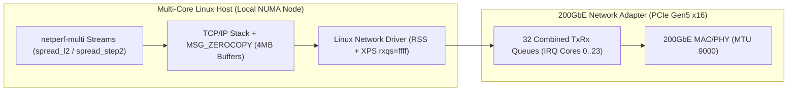

# Architecture White Paper & Empirical Benchmark Study Template (`Diátaxis Concept`)

<!-- METADATA_HEADER_START -->
- **Document ID**: `DOC-TEMPLATE-WHITE-PAPER-003` | **Version**: `v3.2` | **Status**: `Canonical Template`
- **Created Date**: `2026-11-09` | **Last Updated Date**: `2026-11-09`
- **Target Scope**: Technical White Papers (`WP-*`), Architecture Studies, and Multi-Core Benchmark Papers
- **Summary**: Canonical white paper template for `100GbE`–`800GbE` network adapters and multi-core server architecture studies under Rules `D1`–`D10` `v3.2`.
<!-- METADATA_HEADER_END -->

> [!NOTE]
> **External Sanitization & Evidence Tier 1 Standard**:
> Use RFC 5737 / RFC 2544 documentation IPv4 addresses (`192.0.2.x` / `198.51.100.x` / `203.0.113.x`) and RFC 7042
> documentation MAC addresses (`00:00:5e:00:53:xx`) in all public examples. Format data rates without a space between
> the number and unit (`200GbE`, `100GbE`, `25GbE`, `191.4Gb/s`).

---

## 1. Executive Summary & Key Architectural Takeaways

Summarize the architectural problem, software/hardware design, and empirical performance results in `3`–`4` concise
bullet points (`<= 25` words per sentence):

- **NUMA & Cache-Aware Core Partitioning**: Node-local IRQ, application, and isolation core pools eliminate cross-socket
  cache-coherency stalls on high-core-count servers.
- **L2 Cache Module Spreading (`spread_l2` / `spread_step2`)**: Spreading concurrent network streams across shared-L2
  core modules prevents L2 cache-thrashing bottlenecks at `200GbE`.
- **Per-Core `netserver` Pool Scaling**: Running dedicated per-core `netserver` listeners on ports `18600 + core_id`
  eliminates control-socket accept serialization at `16`–`64` parallel flows.

---

## 2. Sanitized Hardware & Testbed Topology Matrix (`3`-Column Portrait PDF Layout)

Keep white paper tables to `3` columns so they render without clipping or horizontal scrolling in portrait PDF exports
and GitHub views.

| Topology Profile & Sanitized IP | Host CPU, Cache & NUMA Architecture | Network Adapter & Link Configuration |
| --- | --- | --- |
| **`Profile A` — P-Core (`SMT`)** DUT: `192.0.2.11` LP: `192.0.2.12` | **Multi-Core P-Core Server** `2` Threads/Core (`SMT`), Dedicated `2` MB L2 Layout: `spread_step2` (`TX=2048`, `RX=4096`) | **High-Speed `200GbE` Network Adapter** Mode: `200GbE` (`PCIe Gen5 x16`, `504.12` Gbps eff.) MTU: `9000` (`5`-Layer TX Scheduler) |
| **`Profile B` — E-Core (`Shared-L2`)** DUT: `198.51.100.11` LP: `198.51.100.12` | **High-Density E-Core Server** `1` Thread/Core, `4` Cores per `4` MB L2 Module Layout: `spread_l2` (`TX=512`, `RX=4096`) | **High-Speed `200GbE` Network Adapter** Mode: `200GbE` / `8x25GbE` LACP Breakout MTU: `9000` / `1500` |

---

## 3. Kernel & Hardware Data-Path Architecture (`Mermaid` Diagram Standard)

Quote all Mermaid node labels that contain parentheses, brackets, or colons (`id["Label (Detail)"]`) and use supported
diagram types (`flowchart LR`, `flowchart TD`, `sequenceDiagram`, `stateDiagram-v2`):

---

## 4. Empirical Benchmark Telemetry (`Evidence Tier 1`) & Scope Caveats

Always state workload caveats explicitly (such as single-flow LACP hash behavior and TX descriptor ring sizing on
shared-L2 E-core architectures):

| Workload & Stream Count | Measured Throughput & Stability | Engineering Caveat & Tuning Profile |
| --- | --- | --- |
| **16-Stream `TCP_STREAM` (`MTU 9000`)** netperf-multi -n 16 --direction tx Per-Core `netserver` (`18600+c`) | **Aggregate**: `189.4Gb/s` (`200GbE`) **Run-to-Run CV**: `0.42%` (`<= 5%` gate) **Active CPU Util**: `41.5%` | Use `tx_ring=512` on shared-L2 E-core hosts to avoid L2/LLC descriptor thrashing (`netperf-tuner --apply-bkm auto`). |
| **Bidirectional `BX` (`16 TX + 16 RX`)** netperf-multi -n 16 --direction bx Disjoint TX/RX Core Pools | **Aggregate**: `352.8Gb/s` (`200GbE` Full-Duplex) **PCIe DMA Faults**: `DMAR=0` **Queue Restarts**: `0` | Allocate strictly disjoint physical core pools for TX and RX streams (`allocate_bx_cores`). |

---

## 5. Reproducibility Appendix & Canonical Profile Reference

Link directly to the canonical YAML tuning profiles and validation test suite:

1. **Canonical Profiles**: [200g-ecore.yaml](../dev/profiles/200g-ecore.yaml) and
   [200g-pcore.yaml](../dev/profiles/200g-pcore.yaml).
2. **Validation Suite**: [test_modernization.py](../dev/tests/test_modernization.py) and
   [TECHNICAL_WHITE_PAPER.md](../dev/docs/TECHNICAL_WHITE_PAPER.md).

---

<!-- METADATA_FOOTER_START -->
### Document Search & Discovery Metadata

| Field | Value |
| --- | --- |
| **File Path** | templates/<wbr>TEMPLATE_<wbr>03<wbr>_Architecture_<wbr>White_<wbr>Paper_and_<wbr>Benchmark_<wbr>Study.<wbr>md |
| **Created / Last Updated** | `2026-11-09` / `2026-11-09` |
| **Keywords / Search Tags** | `White Paper Template`, `Benchmark Study`, `Diataxis Concept`, `RFC 5737 Sanitization`, `Rules D1-D10 v3.2` |
| **Drivers & Subsystems** | `Linux networking`, `MSG_ZEROCOPY`, `NUMA topology`, `netperf_copilot` |
| **Validation / Patch IDs** | `DOC-TEMPLATE-WHITE-PAPER-003`, `D1-D10 v3.2`, `MD013`, `D7-ID-MATCH` |
<!-- METADATA_FOOTER_END -->
