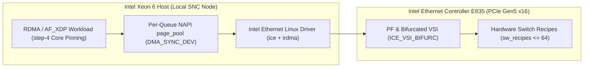

# Intel® Architecture White Paper & Empirical Benchmark Study Template (`Diátaxis Concept`)

<!-- METADATA_HEADER_START -->
- **Document ID**: `DOC-TEMPLATE-WHITE-PAPER-003` | **Version**: `v3.2` | **Status**: `Canonical Template`
- **Created Date**: `2026-11-09` | **Last Updated Date**: `2026-11-09`
- **Target Scope**: Technical White Papers (`WP-*`), Architecture Studies, and Competitive Benchmark Papers
- **Summary**: Canonical Intel® white paper template for **Intel® Ethernet 800 Series** (**Intel® Ethernet Controller E835** and **Intel® Ethernet Network Adapter E835-CC**) and **Intel® Xeon® 6 Processor** studies under Rules `D1`–`D10` `v3.2`.
<!-- METADATA_HEADER_END -->

> [!NOTE]
> **External Sanitization & Evidence Tier 1 Standard**:
> Replace all internal lab management IPv4 addresses (`10.x.x.x`) with RFC 2544 / RFC 5737 documentation addresses
> (`198.18.x.x` / `192.0.2.x`) and replace hardware MAC addresses with RFC 7042 addresses (`00:00:5e:00:53:xx`). Format
> all data rates without a space between the number and unit (`200GbE`, `100GbE`, `25GbE`, `194.6Gb/s`).

---

## 1. Executive Summary & Key Architectural Takeaways

Summarize the architectural problem, hardware innovation on the **Intel® Ethernet Controller E835**, and empirical
performance results in `3`–`4` concise bullet points (`<= 25` words per sentence):

- **Sub-NUMA Clustering (`SNC-3`) Alignment**: Node-local queue, IRQ, and `page_pool` allocation eliminates cross-UPI
  cache-coherency stalls on **Intel® Xeon® 6 Processor** platforms.
- **Zero-Copy Hardware Isolation (`ICE_VSI_BIFURC`)**: Dedicated hardware Queue Sets (`QSets`) deliver line-rate
  `200GbE` throughput while isolating kernel management traffic (`DMAR=0`).
- **Active-Active RoCEv2 LACP LAG**: Hardware switch recipes (`ice_lag-1.3.2.5.pkg`) provide sub-millisecond failover
  and `2x` aggregate bandwidth across multi-QP workloads.

---

## 2. Sanitized Hardware & Testbed Topology Matrix (`3`-Column Portrait PDF Layout)

Keep white paper tables to `3` columns so they render without clipping or horizontal scrolling in portrait PDF exports
(`PDF_REPO` / `DOC_REPO`).

| Testbed ID & Sanitized IP | Host CPU, Memory & Kernel | Network Adapter, Firmware & Switch Fabric |
| --- | --- | --- |
| **`TB1` — SNC-3 Performance** Mgmt: `198.18.84.106` / `.107` Data: `198.18.10.1` / `.2` | **Intel® Xeon® 6 Processor** (`6980P`) SNC-3 (`6` NUMA nodes, `512` threads) Kernel: `6.12+` (`DRV-F01`–`F13`) | **Intel® Ethernet Network Adapter E835-CC** Mode: `2x200GbE` (`PCIe Gen5 x16`) DDP: `ice_lag-1.3.2.5.pkg` |
| **`TB2` — Multi-Switch LAG** Mgmt: `198.18.84.118` / `.120` Data: `198.18.20.1` / `.2` | **Intel® Xeon® 6 Processor** (`6980E+`) `528` E-Cores (`step-4` L2 stride) Kernel: `6.12+` + `rdma-core-61.0` | **Intel® Ethernet Network Adapter E835-CC** Mode: `2x100GbE` `802.3ad` LACP Switch: Dell OS10 / Arista EOS (`MTU 9214`) |

---

## 3. Kernel & Hardware Data-Path Architecture (`Mermaid` Diagram Standard)

Quote all Mermaid node labels that contain parentheses, brackets, or colons (`id["Label (Detail)"]`) and use supported
diagram types (`flowchart LR`, `flowchart TD`, `sequenceDiagram`, `stateDiagram-v2`):

---

## 4. Empirical Benchmark Telemetry (`Evidence Tier 1`) & Scope Caveats

Always state workload caveats explicitly (such as single-QP `layer3+4` hash polarization on `802.3ad` bonds and
`ring=512`
microburst limits under zero-copy `AF_XDP`):

| Workload & Stream / QP Count | Measured Throughput & Latency | Engineering Caveat & Tuning Profile |
| --- | --- | --- |
| **Multi-QP RoCEv2 Write** ib_write_bw -q 8 -T 104 -R MTU: `4096` (RoCE) / `9000` (L2) | **Aggregate**: `191.8Gb/s` (`2x100GbE`) **99.9% Tail Latency**: `2.1 us` **PFC Pause Storms**: `0` | Requires `>= 2` QPs (`-q 8`) to distribute flows across `layer3+4` LACP hash buckets (`WP-002`). |
| **Zero-Copy `AF_XDP` (`ICE_VSI_BIFURC`)** Ring Size: `2048` descriptors Profile: `bifurcated-af-xdp-zero-copy` | **Throughput**: `196.4Gb/s` (`200GbE`) **PCIe DMA Faults**: `DMAR=0` **CPU Reduction**: `-42%` vs. `sk_buff` | Use `ring >= 2048` for line-rate `200GbE` bursts; `ring=512` is limited to low-rate RPC profiles. |

---

## 5. Reproducibility Appendix & Canonical Profile Reference

Link directly to the canonical JSON tuning profile and validation suite:

1. **Canonical Profile**: [e835_canonical_profiles.json](../kb/tuning/e835_canonical_profiles.json) (`v2.2.0`, validated
   against [e835_canonical_profiles.schema.json](../schemas/e835_canonical_profiles.schema.json)).
2. **Validation Gate**:
   [grade_a_908_validation_architecture.md](../kb/validation/grade_a_908_validation_architecture.md)
   and [dmesg_dmar_mdd_zero_tolerance_gate.md](../kb/validation/dmesg_dmar_mdd_zero_tolerance_gate.md).

---

<!-- METADATA_FOOTER_START -->
### Document Search & Discovery Metadata

| Field | Value |
| --- | --- |
| **File Path** | templates/<wbr>TEMPLATE_<wbr>03<wbr>_Architecture_<wbr><wbr>White_<wbr>Paper_and_<wbr>Benchmark_<wbr><wbr>Study.<wbr>md |
| **Created / Last Updated** | `2026-11-09` / `2026-11-09` |
| **Keywords / Search Tags** | `White Paper Template`, `Benchmark Study`, `Diataxis Concept`, `RFC 2544 Sanitization`, `Rules D1-D10 v3.2` |
| **Drivers & Subsystems** | `ice`, `irdma`, `ICE_VSI_BIFURC`, `AF_XDP`, `page_pool`, `SNC-3`, `RoCEv2 LAG` |
| **Validation / Patch IDs** | `DOC-TEMPLATE-WHITE-PAPER-003`, `D1-D10 v3.2`, `WP-001..004`, `MOD-WP004-A` |
<!-- METADATA_FOOTER_END -->
