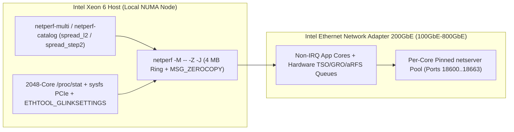

# Netperf Modernization (`netperf_copilot`) — Architecture & Insights — Wiki

<!-- METADATA_HEADER_START -->
- **Document ID**: `DOC-NETPERF-WIKI-ARCH-INSIGHTS-002` | **Version**: `v3.2` | **Status**: `Active`
- **Created Date**: `2026-11-09` | **Last Updated Date**: `2026-11-09`
- **Target Scope**: `netperf_copilot` Central Wiki & 5-Page Repository Wiki Pack (`TEMPLATE-06`)
- **Summary**: Architectural design and empirical engineering insights for the modernized `netperf` C engine and Python qualification suite across **Intel® Ethernet 800 Series** (**200GbE Ethernet Controller** and **200GbE Network Adapter**) and **Intel® Xeon® 6 Processor** platforms.
<!-- METADATA_HEADER_END -->

> [!NOTE]
> **Wiki Navigation**: Return to [Home](https://github.com/thehevy/netperf_copilot/wiki) or review the
> [Commit Log & Roadmap](https://github.com/thehevy/netperf_copilot/wiki/Commit-Log-and-Roadmap),
> [Executive Summary](https://github.com/thehevy/netperf_copilot/wiki/Executive-Summary), and
> [Technical White Paper](https://github.com/thehevy/netperf_copilot/wiki/Technical-White-Paper).

---

## 1. Key Technical Insights & System Architecture (`3`-Column Zero-Scroll Table)

| Architectural Pillar | Problem Solved on 100GbE–800GbE Fabrics | Modernized Implementation & Verification Gate |
| --- | --- | --- |
| **1. Core C Engine (`src/`)** OMNI `-M`, `-Z` Zero-Copy, `4 MB` Buffers | Legacy `netperf` caps `MAXMESSAGESIZE` at `1 MB`, truncates `/proc/stat` at `256` CPUs, and overflows `ETHTOOL_GSET` above `65Gb/s`. | Scales `MAXMESSAGESIZE` to `4 MB`, adds `SO_ZEROCOPY`/`MSG_ZEROCOPY` (`-Z`) with `MSG_ERRQUEUE` draining, tracks `2048` cores (`active_cpu_util`), and queries 32-bit `ETHTOOL_GLINKSETTINGS`. |
| **2. Silicon-Aware Topology** `netperf_topology.py` & `netserver-manager` | Packing flows onto shared 4-core L2 modules on E-Core CPUs or colliding with NIC IRQ cores degrades `200GbE` throughput by `25%–40%`. | Auto-selects spread_l2 ([0, 4, 8, 12...]) on **Intel® Xeon® 6 Processor** E-Core and spread_step2 on P-Core SMT; spawns lockless per-core netserver` pools (`18600 + core`). |
| **3. Pre-Flight & BKM Tuning** `netperf-preflight` & `netperf-tuner` | Asymmetric ring sizes, active `irqbalance`, dual XPS maps, and default socket buffers (`212 KB`) cause bimodal variance. | Enforces `24` anti-affinity rules (`AA-001`–`AA-024`), runs a live warmup stability gate (`CV <= 5.0%`), and applies `ecore` (`tx_ring=512`) or `pcore` (`tx_ring=2048`) BKMs. |
| **4. Qualification & Fault Gate** `netperf-catalog` & `netperf_report.py` | Manual multi-stream sweeps miss transient `DMAR` IOMMU faults, `MDD` events, or `tx_timeout` resets in `dmesg`. | Automates `4` qualification suites (`flow-scaling`, `core-locality`, `ring-coalesce-matrix`, `lag-failover-qos`) with `U1`–`U13` `dmesg` and `ethtool -S` zero-tolerance gates. |

---

## 2. Data-Path & Control-Plane Architecture (`Mermaid` Diagram)

---

## 3. Grounded Reference Guides in This Wiki (`3`-Column Table)

| Guide Category | Wiki Page Link | Core Coverage |
| --- | --- | --- |
| **Executive & White Paper** | [Executive Summary](https://github.com/thehevy/netperf_copilot/wiki/Executive-Summary) [Technical White Paper](https://github.com/thehevy/netperf_copilot/wiki/Technical-White-Paper) | Strategic overview, mathematical BDP/cache models, and `4` empirical `200GbE`–`600GbE` case studies. |
| **Engine & Platform Tuning** | [Core Engine & OMNI Guide](https://github.com/thehevy/netperf_copilot/wiki/Core-Engine-and-OMNI-Guide) [200GbE–800GbE & Xeon 6 Guide](https://github.com/thehevy/netperf_copilot/wiki/High-Speed-200GbE-800GbE-and-Xeon6-Guide) | Legacy vs. `-M` OMNI flags, `-J` JSON schema, output presets, P-Core vs. E-Core pinning, and BKM tuning. |
| **CLI, Profiles & Fault Gates** | [CLI Tools Reference](https://github.com/thehevy/netperf_copilot/wiki/CLI-Tools-Reference) [Profiles & Catalog](https://github.com/thehevy/netperf_copilot/wiki/Test-Profiles-and-Qualification-Catalog) [Pre-Flight & Fault Gate](https://github.com/thehevy/netperf_copilot/wiki/Pre-Flight-Checks-and-Fault-Monitoring) | All `11` CLI tools, `15` YAML workload profiles, `4` catalog suites, `AA-001`–`AA-024`, and `U1`–`U13` `dmesg` gates. |

---

<!-- METADATA_FOOTER_START -->
### Document Search & Discovery Metadata

| Field | Value |
| --- | --- |
| **File Path** | `wiki/Architecture-and-Insights.md` |
| **Created / Last Updated** | `2026-11-09` / `2026-11-09` |
| **Keywords / Search Tags** | `Architecture and Insights`, `netperf_copilot Wiki`, `OMNI MSG_ZEROCOPY`, `Xeon 6 spread_l2`, `Rules D1-D10 v3.2` |
| **Drivers & Subsystems** | `ice`, `irdma`, `netperf`, `netserver`, `netperf-multi`, `netperf-preflight`, `netperf-tuner` |
| **Validation / Patch IDs** | `DOC-NETPERF-WIKI-ARCH-INSIGHTS-002`, `D1-D10 v3.2`, `MD013`, `D7-ID-MATCH` |
<!-- METADATA_FOOTER_END -->
