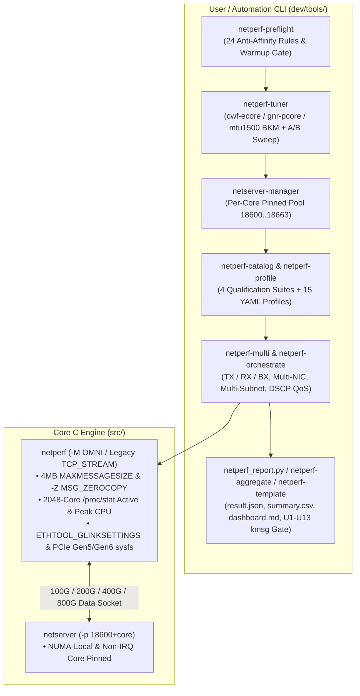

# Netperf Modernized Fork Wiki

Welcome to the official Wiki for **`netperf_copilot`** — the modernized, high-speed (10GbE to 800GbE) and Intel Xeon 6 (P-Core & E-Core) ready fork of the classic `netperf` network performance benchmark.

---

## 🌟 Highlights at a Glance

- **100% Backwards Compatible**: Running `netperf -H <host>` without `-M` executes the classic `TCP_STREAM` columnar test so existing scripts never break.
- **Modern OMNI Mode (`-M`)**: Enables structured `KEYVAL` (default with `-M`), `JSON` (`-- -J`), `CSV` (`-- -o`), and `HUMAN` (`-- -O`) output, plus named output presets (`minimal`, `default`, `throughput`, `latency`, `cpu`, `verbose`).
- **100G–800G Core C Engine Upgrades (`src/`)**:
  - `MAXCPUS` scaled to **2048** cores with `/proc/stat` softirq/active-CPU tracking (`local_active_cpu_util`, `local_peak_cpu_id`, `local_softirq_pct`).
  - `MAXMESSAGESIZE` raised from 1 MB to **4 MB** (`4194304` bytes) for high-BDP and zero-copy transfers.
  - Native **`SO_ZEROCOPY` / `MSG_ZEROCOPY`** (`-- -Z`) support with automatic `MSG_ERRQUEUE` completion draining.
  - Direct Linux `ETHTOOL_GLINKSETTINGS` (100G/200G/400G/800G link speed, driver, firmware) and sysfs PCIe Gen5/Gen6 (`32.0 GT/s`, `64.0 GT/s`, `x16`, NUMA node) telemetry.
- **Production Python Tooling (`dev/tools/`)**:
  - Zero mandatory external dependencies (pure Python 3 stdlib fallbacks for YAML, Jinja2, and SSH).
  - Topology-aware multi-flow runner (`netperf-multi`), per-core `netserver` pool manager (`netserver-manager`), 24-rule E835 pre-flight checker (`netperf-preflight`), automated BKM tuner & A/B sweep engine (`netperf-tuner`), 4-suite qualification catalog (`netperf-catalog`), YAML profile runner (`netperf-profile`), multi-host SSH orchestrator (`netperf-orchestrate`), live ANSI dashboard (`netperf-monitor`), statistical analyzer (`netperf_stats.py`), result aggregator (`netperf-aggregate`), and report template engine (`netperf-template`).

---

## 📖 Wiki Navigation

1. **[[Home]]** — Project overview, architecture diagram, and quick links
2. **[[Getting-Started-and-Installation]]** — Building `netperf`, configure options, and installing `dev/tools/`
3. **[[Core-Engine-and-OMNI-Guide]]** — Using `-M` OMNI mode, JSON/CSV/KEYVAL formats, output presets, and `-Z` zero-copy
4. **[[High-Speed-200G-800G-and-Xeon6-Guide]]** — Intel Xeon 6 P-Core (Granite Rapids) vs E-Core (Clearwater Forest / Sierra Forest) topology layout (`spread_l2`, `spread_step2`), per-core `netserver-manager`, and `ice` driver tuning
5. **[[CLI-Tools-Reference]]** — Complete reference for all 10 tools in `dev/tools/`
6. **[[Test-Profiles-and-Qualification-Catalog]]** — All 15 built-in YAML profiles and the 4 standardized qualification suites (`flow-scaling`, `core-locality`, `ring-coalesce-matrix`, `lag-failover-qos`)
7. **[[Pre-Flight-Checks-and-Fault-Monitoring]]** — All 24 E835 anti-affinity rules (`AA-001`–`AA-024`), `U1`–`U13` `dmesg`/`ethtool -S` fault gates, and AI-Driven Validation `result.json` schema

---

## 🏗️ Modernization Architecture



---

## ⚡ 60-Second Quick Start

```bash
# 1. Build optimized binaries
./dev/scripts/build.sh --type optimized

# 2. Run pre-flight hardware/driver check on your high-speed NIC
./dev/tools/netperf-preflight -i ens801f0np0

# 3. Apply Xeon 6 / ice driver BKM tuning (or --dry-run to preview)
./dev/tools/netperf-tuner -i ens801f0np0 --apply-bkm auto --dry-run

# 4. Start per-core pinned netserver pool on the Load Partner (LP)
./dev/tools/netserver-manager --start -i ens801f0np0 --base-port 18600

# 5. Run 16-stream bidirectional (16 TX + 16 RX) 200GbE test with dmesg fault gate
./dev/tools/netperf-multi -H 192.168.10.2 -i ens801f0np0 -t OMNI \
    --direction bx -n 16 -l 30 --affinity --per-core-netserver \
    --base-port 18600 --check-kmsg --export bx_16flows.json -- -m 65536 -D
```
