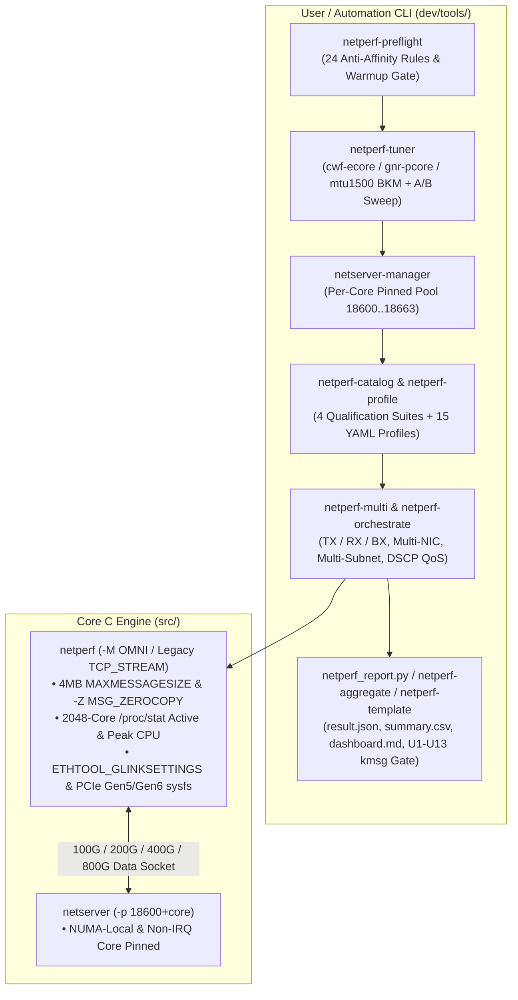

# Netperf Modernized Fork Wiki

<!-- METADATA_HEADER_START -->
- **Document ID**: `DOC-NETPERF-WIKI-HOME` | **Version**: `v3.2` | **Status**: `Active`
- **Created Date**: `2026-11-05` | **Last Updated Date**: `2026-11-09`
- **Target Scope**: `netperf_copilot` High-Speed 100GbE–800GbE Qualification & Automation Suite
- **Summary**: Technical documentation for Netperf Modernized Fork Wiki under Rules `D1`–`D10` `v3.2`.
<!-- METADATA_HEADER_END -->


Welcome to the official Wiki for **`netperf_copilot`** — the modernized, high-speed (10GbE to 800GbE) and multi-core
server (P-Core SMT & E-Core Shared-L2) ready fork of the classic `netperf` network performance benchmark.

---

## 🌟 Highlights at a Glance

- **100% Backwards Compatible**: Running `netperf -H <host>` without `-M` executes the classic `TCP_STREAM` columnar
  test so existing scripts never break.
- **Modern OMNI Mode (`-M`)**: Enables structured `KEYVAL` (default with `-M` ), `JSON` (`-- -J`), `CSV` (`-- -o`), and
  `HUMAN` (`-- -O`) output, plus named output presets (`minimal`, `default` , `throughput` , `latency` , `cpu` ,
  `verbose` ).
- **100G–800G Core C Engine Upgrades (`src/`)**:
  - `MAXCPUS` scaled to **2048** cores with `/proc/stat` softirq/active-CPU tracking (`active_cpu_util`, `peak_cpu_id`).
  - `MAXMESSAGESIZE` raised from 1 MB to **4 MB** (`4194304` bytes) for high-BDP and zero-copy transfers.
  - Native **`SO_ZEROCOPY` / `MSG_ZEROCOPY`** (`-Z`) support with automatic `MSG_ERRQUEUE` completion draining.
  - Direct Linux `ETHTOOL_GLINKSETTINGS` (100G/200G/400G/800G link speed, driver, firmware) and sysfs PCIe Gen5/Gen6
    (`32.0 GT/s`, `64.0 GT/s` , `x16` , NUMA node) telemetry.
- **Production Python Tooling (`dev/tools/`)**:
  - Zero mandatory external dependencies (pure Python 3 stdlib fallbacks for YAML, Jinja2, and SSH).
  - Topology-aware multi-flow runner (`netperf-multi`), per-core `netserver` pool manager (`netserver-manager`), 24-rule
    pre-flight checker (`netperf-preflight`), automated BKM tuner & A/B sweep engine (`netperf-tuner`), 4-suite
    qualification catalog (`netperf-catalog`), YAML profile runner (`netperf-profile`), multi-host SSH orchestrator
    (`netperf-orchestrate`), live ANSI dashboard (`netperf-monitor`), statistical analyzer (`netperf_stats.py`), result
    aggregator (`netperf-aggregate`), and report template engine (`netperf-template`).

---

## 📖 Wiki Navigation

1. **[Home](Home.md)** — Project overview, architecture diagram, and quick links
2. **[Executive Summary](Executive-Summary.md)** — Strategic overview of the modernization project, the four engineering
   pillars, and quantified before-vs-after impact
3. **[Technical White Paper](Technical-White-Paper.md)** — In-depth 10-page architectural white paper explaining why
   `netperf` modernization is essential at 100G–800G, mathematical models, and 4 empirical case studies
4. **[Getting Started & Installation](Getting-Started-and-Installation.md)** — Building `netperf` , configure options,
   and installing `dev/tools/`
5. **[Core Engine & OMNI Guide](Core-Engine-and-OMNI-Guide.md)** — Using `-M` OMNI mode, JSON/CSV/KEYVAL formats, output
   presets, and `-Z` zero-copy
6. **[High-Speed 200G–800G & Multi-Core Guide](High-Speed-200G-800G-and-Xeon6-Guide.md)** — P-Core SMT (`spread_step2`)
   vs. E-Core Shared-L2 (`spread_l2`) topology layout, per-core `netserver-manager` , and driver tuning
7. **[CLI Tools Reference](CLI-Tools-Reference.md)** — Complete reference for all 11 tools in `dev/tools/`
8. **[Test Profiles & Qualification Catalog](Test-Profiles-and-Qualification-Catalog.md)** — All 15 built-in YAML
   profiles and the 4 standardized qualification suites (`flow-scaling`, `core-locality` , `ring-coalesce-matrix` ,
   `lag-failover-qos` )
9. **[Pre-Flight Checks & Fault Monitoring](Pre-Flight-Checks-and-Fault-Monitoring.md)** — All 24 anti-affinity rules
   (`AA-001`–`AA-024`), `U1` –`U13` `dmesg` /`ethtool -S` fault gates, and AI-Driven Validation `result.json` schema

---

## 🏗️ Modernization Architecture



---

## ⚡ 60-Second Quick Start

```bash
# 1. Build optimized binaries
./dev/scripts/build.sh --type optimized

# 2. Run pre-flight hardware/driver check on your high-speed NIC
./dev/tools/netperf-preflight -i eth0

# 3. Apply driver BKM tuning (or --dry-run to preview)
./dev/tools/netperf-tuner -i eth0 --apply-bkm auto --dry-run

# 4. Start per-core pinned netserver pool on the Link Partner (LP)
./dev/tools/netserver-manager -i eth0 --action start -n 32 --base-port 18600

# 5. Run 16-stream bidirectional (16 TX + 16 RX) 200GbE test with dmesg fault gate
./dev/tools/netperf-multi -H 192.168.10.2 -i eth0 -t OMNI \
    --direction bx -n 16 -l 30 --affinity --per-core-netserver \
    --base-port 18600 --check-kmsg -o json --export bx_16flows.json -- -m 65536 -D
```

---

<!-- METADATA_FOOTER_START -->
### Document Search & Discovery Metadata

| Field | Value |
| --- | --- |
| **File Path** | `wiki/Home.md` |
| **Created / Last Updated** | `2026-11-05` / `2026-11-09` |
| **Keywords / Search Tags** | `netperf_copilot`, `OMNI`, `100GbE-800GbE`, `Intel Ethernet E835`, `Xeon 6`, `Rules D1-D10 v3.2` |
| **Drivers & Subsystems** | `ice`, `irdma`, `netperf`, `netserver`, `netperf-multi`, `netperf-preflight` |
| **Validation / Patch IDs** | `DOC-NETPERF-WIKI-HOME`, `D1-D10 v3.2`, `MD013`, `D7-ID-MATCH` |
<!-- METADATA_FOOTER_END -->
